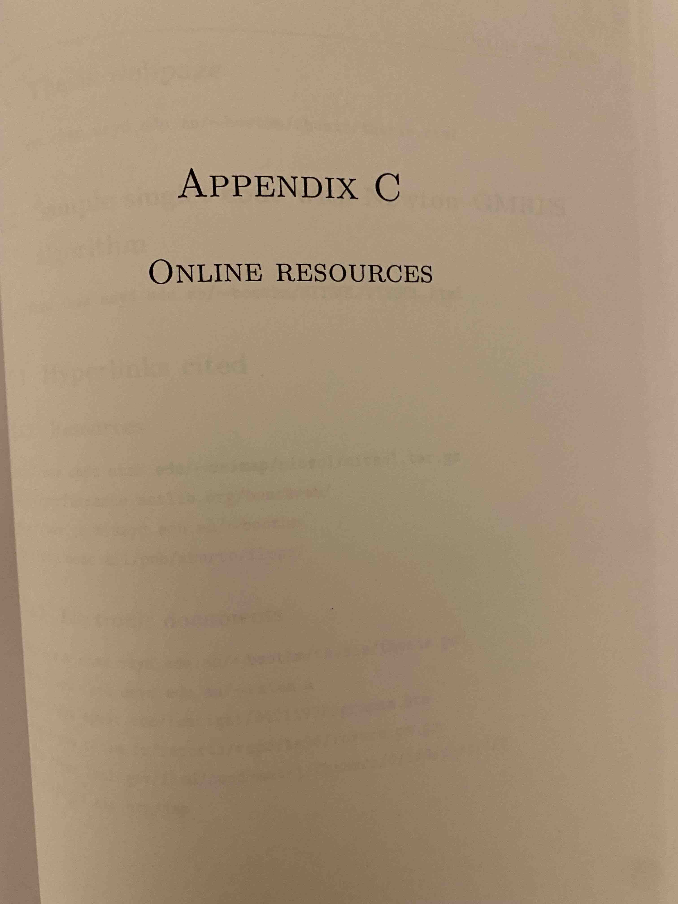

# Charged fluids near interfaces: Integral equation theory (Ph.D. Thesis)

Modern Python reimplementation of the 1998 Ph.D. thesis *Charged fluids near interfaces: Integral equation theory*, with a UI-free science core, Streamlit app, and bulk Ornstein–Zernike pipeline.

## Web app

Production: [https://phd.databooth.com.au](https://phd.databooth.com.au) (Streamlit on Google Cloud Run).

## Background

The original thesis included electronic resources at the University of Sydney (FORTRAN-era materials are no longer hosted). This repository rebuilds the wall-fluid integral-equation workflow and bulk \(c(r)\) generation in a tested, uv-managed stack.



## Status

| Fluid | Wall solve | Bulk \(c_\mathrm{short}\) artefact | Notes |
|-------|------------|--------------------------------------|--------|
| **lj1** | Ready | `data/bulk/lj1.cr.dat` | One-component LJ |
| **lj2** | Ready | `data/bulk/lj2.cr.dat` | Two-component LJ |
| **kcl** | Experimental | `data/bulk/kcl.cr.dat` (Ng/PY) | Short-range tail improved; \(g(r)\) residual still elevated |
| **h2o** | Experimental | `data/bulk/h2o.cr.dat` (digitised Fig 3.12) | **CF1** central-force water (O, H) |
| **2_2** | Experimental | `data/bulk/2_2.cr.dat` | Soft-core 2:2 electrolyte (Ng/PY) |
| **1_1** | Experimental | `data/bulk/1_1.cr.dat` | Soft-core 1:1 aqueous electrolyte (Ng/HNC) |

Core package: **`src/charged_fluids/`** (Python 3.14). Streamlit pages under `src/pages/` are thin shims. Shared preparation: `prepare_fluid_run` → `FluidRun`.

Architecture (one line): TOML parameters → bulk Picard OZ (HNC/PY, optional Ng) → wall singlet residual (Newton–Krylov) → Streamlit / Marimo.

## Development (uv + Just)

```bash
just init            # uv sync (Python 3.14)
just test            # pytest
just quality         # ruff + ty + pytest
just app             # Streamlit (localhost)
just bulk-cr lj1     # write data/bulk/{symbol}.cr.dat (+ .meta.json; TOML defaults)
just marimo          # wall-fluid Marimo explorer (Plotly)
just marimo-bulk     # bulk c(r) / parameters explorer (Plotly)
just hooks-install   # prek git hooks
```

Bulk CLI (TOML supplies defaults for points/step/closure when flags are omitted):

```bash
uv run python -m charged_fluids.bulk.cli kcl
```

## Package layout

```
src/charged_fluids/
  modelling.py      # wall kernels, calc_tw, pair index
  setup.py          # FluidRun / prepare_fluid_run
  parameters.py     # TOML fluid table
  units.py          # unit conventions (Å, charge_pair, …)
  bulk/
    oz_solver.py    # Picard OZ (LJ, binary Coulomb+LJ + Ng)
    closures.py     # HNC / PY registry
    transforms.py   # FFT sine transforms (direct fallback)
    cli.py          # artefact generation CLI
data/fluid_parameters.toml   # single source of truth for fluids
data/bulk/                  # generated c(r) artefacts
tests/                      # pytest suite for charged_fluids
docs/blog/                  # progressive notes + capstone
docs/LEGACY.md              # historical trees (do not expand)
docs/FLUIDS.md               # how to add a fluid
```

## Bulk correlation heritage

Historical bulk solvers: [pyOZ](http://pyoz.vrbka.net) (discontinued), fork [ctk3b/pyoz](https://github.com/ctk3b/pyoz), and [elvissoares/PyOZ](https://github.com/elvissoares/PyOZ) (untested). Production path is **`charged_fluids.bulk`**; vendored pyOZ remains under `src/pyoz/` for reference (`just bulk-fluid-pyoz`).

## Documentation and blog

- Capstone before/after: `docs/blog/2026-11-19-capstone-before-after.md`
- Other notes: `docs/blog/`
- Legacy paths: `docs/LEGACY.md`
- Agent-oriented project notes: `WARP.md` (may lag; prefer this README + `charged_fluids` for current behaviour)

## Open work

- Tighten KCl bulk residual / \(g(r)\) and wall smoke with the Ng artefact
- Literature benchmarks (e.g. Pihlajamaa & Janssen PRE 2024 closures; Hansen–McDonald LJ tables)
- Full CF1 bulk OZ regeneration (beyond digitised c(r)); tighter 2-2 thermodynamics
- Optional further speed work on wall `calc_tw` pair convolutions
- Refresh `WARP.md` to match this stack (tooling is ruff/ty/prek, not black/mypy)

## License

MIT
